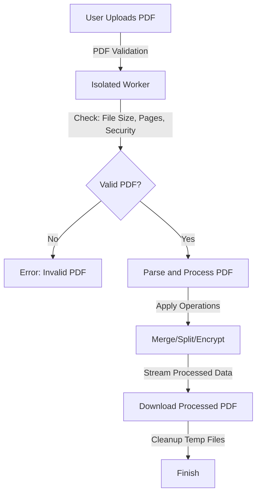

# PDF Merger     

## Executive Summary

**PDF Merger** simplifies PDF workflows by offering a secure, efficient, and user-friendly tool for merging, splitting, and processing PDFs with robust safeguards against malicious or resource-heavy input files. Designed with enterprises in mind, it ensures performance, reliability, and security under adversarial conditions.

## Key Features

- **Merge, Split, and Reorder PDFs**: Combine multiple PDFs, split specific pages, or restructure documents with ease.
- **Encrypted PDF Handling**: Supports password-protected PDFs for both input and output operations.
- **Secure PDF Processing**: Isolated worker architecture with limits on memory, CPU, file size, page count, and processing time for safe handling of untrusted files.
- **Resource-Conscious Design**: Streaming-based processing to minimize memory overhead and prevent decompression bomb vulnerabilities.
- **Temporary File Security**: Unpredictable naming, restrictive permissions, and automatic cleanup using `finally` blocks.
- **Edge Case Resilience**: Handles malformed object graphs, mixed rotations, abrupt worker terminations, and deeply nested structures gracefully.
- **Unit-Tested Robustness**: Comprehensive test suite using `pytest` with scenarios for encrypted files, malformed PDFs, and extreme cases.
- **Lightweight Deployment**: Optimized resource footprint with synthetic fixtures; no large test artifacts committed to version control.

## Architecture & Workflow



## Tech Stack & Tools Breakdown

- **Python 3.8+**: Core programming language for automation and business logic.
- **Streamlit**: Interactive web-based UI for PDF operations.
- **PyPDF**: Secure and maintained library for handling PDF manipulation.
- **pytest**: Comprehensive testing framework for automated quality assurance.
- **Docker**: Optional containerization for isolated deployment environments.

## Quickstart / Installation

### Prerequisites
- Python 3.8 or higher installed on your system.
- Optionally, Docker for containerized operation.

### Clone Repository
```bash
git clone https://github.com/EF361/pdf_merger.git
cd pdf_merger
```

### (Optional) Setup Virtual Environment
```bash
python3 -m venv venv
source venv/bin/activate   # On Windows use: venv\Scripts\activate
```

### Install Dependencies
```bash
pip install -r requirements.txt
```

### Run the Application
```bash
streamlit run app.py
```

### Testing the Application
```bash
pytest tests/
```

### (Optional) Run with Docker
```bash
docker build -t pdf_merger .
docker run -p 8501:8501 pdf_merger
```

---

**Designed and maintained by [Alicia Goh (EF361)]**, empowering secure document workflows. For issues or contributions, please submit a GitHub issue or pull request!