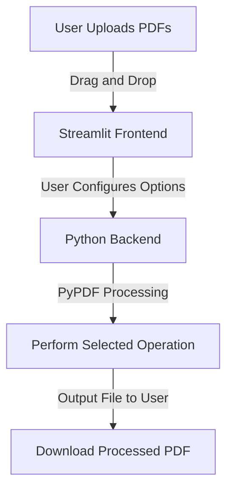

# PDF Merger & Manipulation Tool

[](https://www.python.org/)  
[](https://streamlit.io/)  
[](https://pypdf.readthedocs.io/)  
[](./LICENSE.md)  
[](#quickstart-installation)  

## Executive Summary
PDF Merger & Manipulation Tool empowers users to effortlessly handle their PDF files with a privacy-first, user-friendly interface. Combine, split, encrypt, and customize your PDFs directly in your browser—no uploads, no data leaks!

---

## Key Features
- **Merge PDFs**: Combine multiple PDF files into one seamless document in seconds.
- **Split PDFs**: Extract specific pages or split large PDFs into smaller, manageable chunks.
- **Encrypt PDFs**: Secure sensitive documents with password protection.
- **Drag, Drop, and Reorder**: Easily rearrange PDF files or pages using a visual drag-and-drop interface.
- **Streamlit-powered UI**: Enjoy an intuitive and interactive web app experience.
- **Privacy First**: All processing happens locally on your machine—no file uploads, ensuring data security.
- **Customizable Output Options**: Set page orientation, merging order, and output file names to fit your project needs.

---

## Architecture & Workflow
A streamlined local-first process ensures privacy and high performance from start to finish. Here’s how the tool operates behind the scenes:



---

## Tech Stack & Tools Breakdown
### Programming Languages & Frameworks
- **Python 3.8+**: Core programming language for backend logic.
- **Streamlit**: Lightweight and efficient framework for building the interactive web app.

### Libraries & Dependencies
- **PyPDF**: Handles PDF merging, splitting, and encryption at high performance.
- **Streamlit Components**: Enables the drag-and-drop file upload widget.
- **Other Utilities**: Standard Python packages for exception handling, logging, and I/O operations.

---

## Quickstart / Installation

Clone the repository and jump right into simplifying your PDF tasks. Follow the steps below to set up the project:

1. **Clone the Repository**
   ```bash
   git clone https://github.com/EF361/pdf_merger.git
   cd pdf_merger
   ```

2. **Set Up a Virtual Environment**
   ```bash
   python -m venv venv
   source venv/bin/activate  # On Windows, use venv\Scripts\activate
   ```

3. **Install Dependencies**
   ```bash
   pip install -r requirements.txt
   ```

4. **Run the Application**
   ```bash
   streamlit run app.py
   ```

5. **Access the App**
   Open your browser and navigate to `http://localhost:8501`.

---

## Contributing
Contributions are welcome! Open an issue or submit a pull request to propose new features or fixes.

---

## License
This project is licensed under the MIT License—see the [LICENSE](./LICENSE.md) file for details.

---

Developed with ❤️ by **Alicia Goh (EF361)**, showcasing powerful automation for modern PDF workflows!