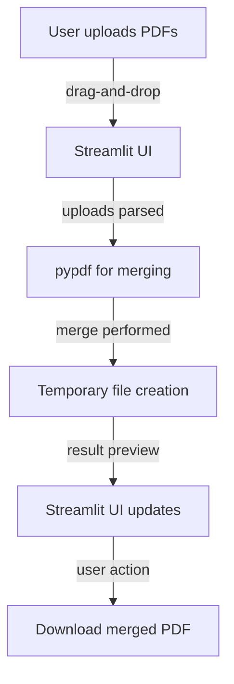

# pdf_merger
A simple PDF merger built with Streamlit.


[](https://mergepdfwizard.streamlit.app)
<!-- Screenshot: add dashboard_preview.png -->

## Overview
The `pdf_merger` is a lightweight tool that lets users combine multiple PDF files into one through a simple web interface. Built using Streamlit, it focuses on ease of use with drag-and-drop functionality and an intuitive dashboard for file handling.

## Features
- Merge multiple PDF files into one document.
- User-friendly web interface with drag-and-drop support (powered by `streamlit-sortables`).
- Configurable Streamlit UI settings managed via `.streamlit/config.toml`.
- Basic encryption and decryption support with `cryptography`.
- File preview showcasing the merged result before download.

## How It Works


## Tech Stack
- **Python** for primary scripting.
- **Streamlit** for the web-based interface.
- **PyPDF** for PDF parsing and merging.
- **Cryptography** for encryption-related operations.

## Getting Started

### Prerequisites
- Python 3.x installed on your system.

### Installation
1. Clone the repository:
   ```bash
   git clone https://github.com/EF361/pdf_merger.git
   cd pdf_merger
   ```
2. Install dependencies using `pip`:
   ```bash
   pip install -r requirements.txt
   ```
3. Run the application:
   ```bash
   streamlit run pdf_merger.py
   ```

4. Open your browser at `http://localhost:8501`.

## Project Structure
```
pdf_merger/
├── .devcontainer/
│   └── devcontainer.json       # Configuration for development in containers
├── .streamlit/
│   └── config.toml             # Customizations for the Streamlit app
├── README.md                   # Project documentation
├── dashboard_preview.png       # Preview image for the dashboard
├── pdf_merger.py               # Main application script
├── requirements.txt            # Project dependencies
└── .gitignore                  # Git ignored files
```

## Roadmap
- [ ] Implement OS-level isolation for secure PDF processing.
- [ ] Add automated vulnerability scanning for dependencies.
- [ ] Optimize handling of malformed or large PDF files.
- [ ] Support advanced configuration options for PDF metadata and layout.

---

Built by [Alicia Goh](https://github.com/EF361)