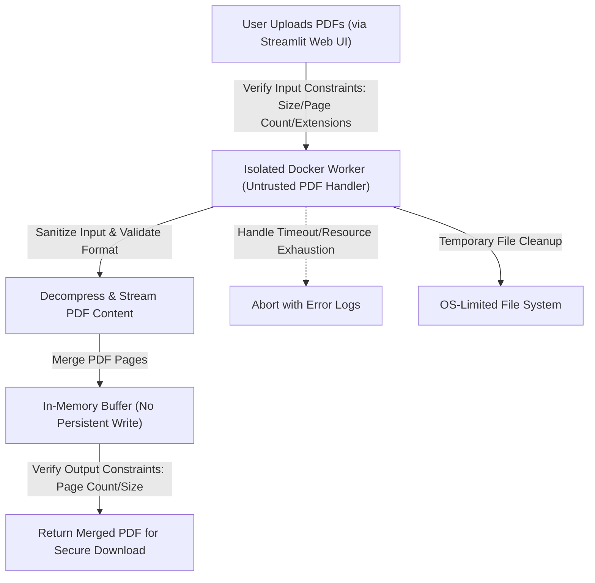

# pdf_merger


-brightgreen)


---

## 🚀 Executive Summary
**pdf_merger** is a robust file-processing application for merging multiple PDF documents securely, efficiently, and at scale. Built with **Streamlit**, it features isolated worker processing, strict file-handling controls, and memory-safe operations to mitigate risks with untrusted input.

---

## 🔑 Key Features
- **Secure File Handling**: Treats all user-provided PDFs as untrusted code, enforcing OS-level CPU, memory, and network restrictions.
- **Isolated Processing Workers**: Dockerized execution ensures complete isolation and monitoring for timeouts, page size, decompression, and recursion.
- **Efficiency & Safety**: Streamlined file-processing pipeline with upload size caps (default: 10 MB), dynamic resource usage profiling, and cleanup for temporary files.
- **Advanced Adversarial Protection**: Detects and defends against malformed xref tables, object streams, recursive graphs, mixed rotations, and encrypted PDFs.
- **Comprehensive Testing & Fuzzing**: Includes fuzzing fixtures and regression tests to maintain stability against edge cases and malformed adversarial inputs.
- **User-Friendly UI**: Built with **Streamlit**, enabling an interactive, lightweight interface for non-technical users.
- **Fully Containerized**: Provides Docker support for seamless deployment and consistent reproducibility.
- **Python 3.8 Compatibility**: Legacy support with clear justification for broader adoption in enterprise settings.

---

## 🛠️ Architecture & Workflow

The **pdf_merger** system follows a secure, isolated workflow to manage and merge PDF files while adhering to best practices for memory and resource control. Here’s a high-level breakdown:



---

## 🧰 Tech Stack & Tools Breakdown

- **Python 3.8+**: Core language for all business logic and integrations.
- **Streamlit**: Enables the interactive front-end for non-technical users.
- **PyPDF**: Powers PDF operations like merging, security handling, and metadata management.
- **Docker**: Ensures isolated, secure, and reproducible PDF processing environments.
- **pytest**: Comprehensive testing, including fuzzing and regression against edge cases.
- **Isolated Worker Processing**: Leverages OS-level restrictions on CPU/memory/network usage for untrusted inputs.
- **Mermaid**: Visual flowchart diagrams for architecture transparency.
- **Fuzz Testing**: Protects against malformed/unexpected PDF structures and adversarial attacks.

---

## ⚡ Quickstart / Installation

### Prerequisites
Ensure you have the following installed:
- Python 3.8+ 
- Docker
- pip

### Step 1: Clone the Repository
```bash
git clone https://github.com/EF361/pdf_merger.git
cd pdf_merger
```

### Step 2: Set Up Virtual Environment and Install Dependencies
```bash
python3 -m venv venv
source venv/bin/activate   # On Windows use 'venv\Scripts\activate'
pip install -r requirements.txt
```

### Step 3: Run Application Locally
```bash
streamlit run app.py
```

Visit `http://localhost:8501` in your browser to access the UI.

### Step 4: (Optional) Run in Docker
```bash
docker build -t pdf_merger .
docker run -p 8501:8501 pdf_merger
```

### Step 5: Testing and Coverage
```bash
pytest --maxfail=5 --disable-warnings
```

### Step 6: Security & Cleanup
- Uploaded PDF files are stored in **secure temporary directories** and are deleted after merging.
- **Ensure Docker containers** are properly shutdown after processing:
  ```bash
  docker ps -a | grep pdf_merger | awk '{print $1}' | xargs docker rm -f
  ```

---

## 🎯 Audit's Key Reflections
1. **Repository Size Control**: Regularly audit large files and remove test artifacts, output files, or binaries exceeding size limits.
2. **Streamed vs. Materialized Operations**: Profile memory consumption for edge cases like highly compressed or malformed PDFs.
3. **Python Support**: Upgrade support to Python >= 3.9 or validate enterprise demand for Python 3.8 legacy support.
4. **Fuzzing Infrastructure**: Expand fixtures for encryption variants, malicious recursion, and mixed orientations.

---

## 🔐 Security Highlights
- Enforces **upload size limits** and decompression analysis pre-parsing.
- Isolated workers defend against **unauthorized code execution**.
- Temporary file locations are **locked-down, cleaned-up post-execution**.
- Protects user data with **memory-safe, non-persistent file streaming**.

---

## 👩‍💻 Maintainer: Alicia Goh (EF361)
EF361 is a dedicated AI & Software Engineer committed to enabling secure, scalable, and developer-friendly solutions for high-risk domains.